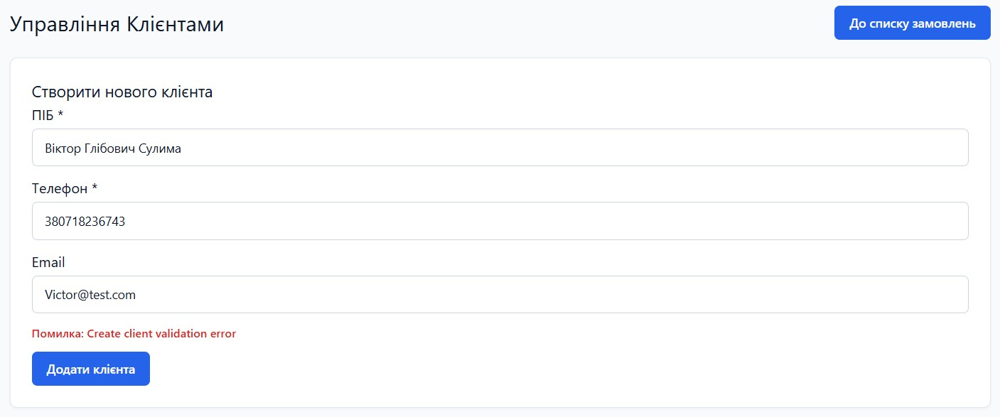
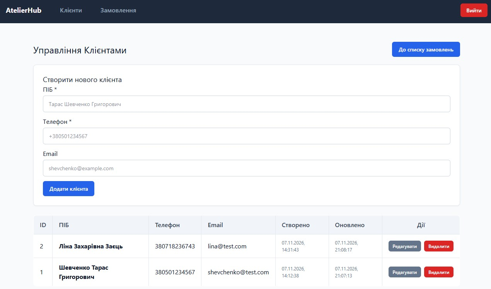
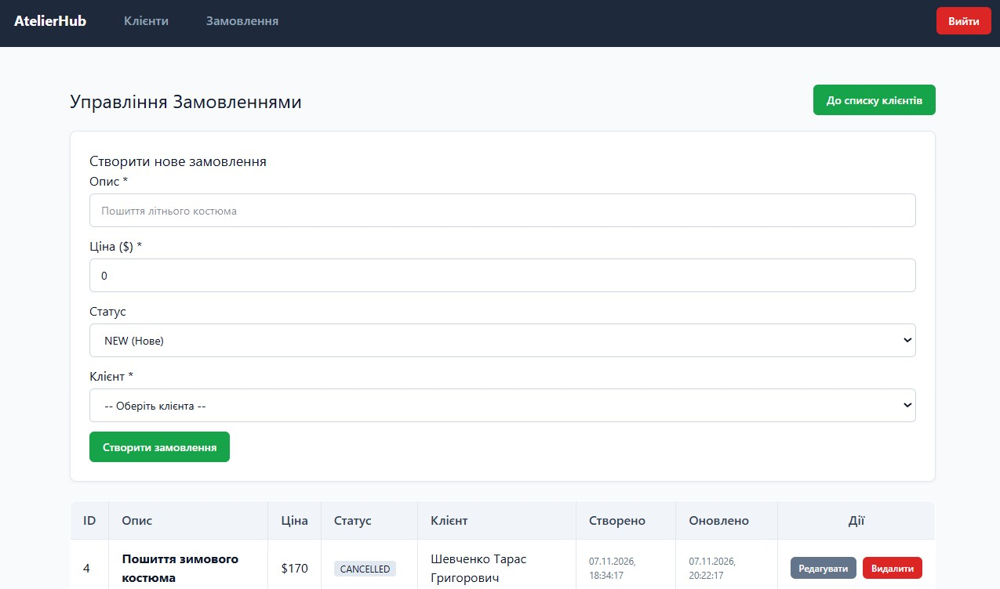
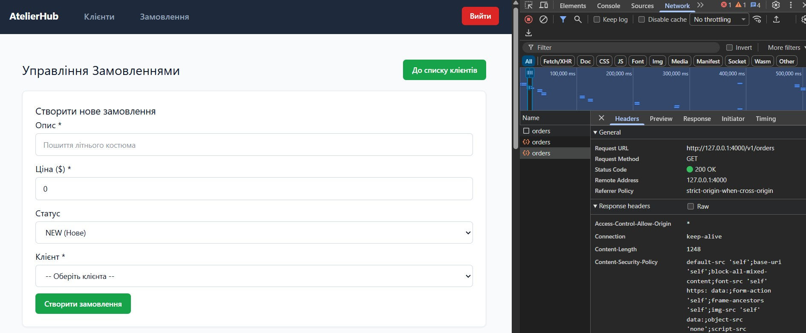

# Лабораторно-практична робота №5: Розширення бекенд-додатку та реалізація REST API

**Предметна область:** Інформаційна система ательє з пошиття одягу

---

## 1. Опис сутностей та зв'язків

У проекті реалізовано дві пов'язані сутності за допомогою TypeORM:

1. **Client (`clients`)** — зберігає інформацію про клієнтів ательє (`id`, `fullName`, `phone`, `email`).
2. **Order (`orders`)** — зберігає інформацію про замовлення на пошиття та ремонт одягу (`id`, `description`, `price`, `status`, `clientId`).

**Тип зв'язку:** `One-To-Many` (Один до Багатьох) між `Client` та `Order` (один клієнт може мати кілька замовлень, але кожне замовлення належить конкретному клієнту).

---

## 2. Перелік API Ендпоінтів

### Клієнти (`/v1/clients`)

- `GET /v1/clients` — отримати список усіх клієнтів
- `GET /v1/clients/:id` — отримати клієнта за ID (включаючи масив його замовлень)
- `POST /v1/clients` — створити нового клієнта
- `PATCH /v1/clients/:id` — оновити дані клієнта
- `DELETE /v1/clients/:id` — видалити клієнта

### Замовлення (`/v1/orders`)

- `GET /v1/orders` — отримати список усіх замовлень (з підтягуванням об'єкта `client` через JOIN)
- `GET /v1/orders/:id` — отримати замовлення за ID (з деталями про клієнта)
- `POST /v1/orders` — створити нове замовлення
- `PATCH /v1/orders/:id` — оновити статус або опис замовлення
- `DELETE /v1/orders/:id` — видалити замовлення

---

## 3. Результати тестування (Postman Screenshots)

### 1. Створення клієнта (`POST /v1/clients`)


### 2. Створення замовлення (`POST /v1/orders`)


### 3. Отримання списку замовлень з автоматичним JOIN (`GET /v1/orders`)


### 4. Отримання клієнта з масивом замовлень (`GET /v1/clients/1`)


<br />
<hr />
<br />

# Лабораторно-практична робота №6: Впровадження сервісного шару, валідації та DTO

**Предметна область:** Інформаційна система ательє з пошиття одягу

---

## 1. Архітектура додатка та розділення відповідальності

У ході виконання рефакторингу проект було переведено на багаторівневу сервісну архітектуру з чітким розділенням відповідальності (Separation of Concerns):

- **Middleware (Валідація):** Перевіряє вхідні HTTP-запити (`req.body`) до того, як вони потраплять у контролер. Забезпечує коректність даних та викидає помилку `400 Bad Request` у разі невідповідності правилам.
- **Controller (Оркестрація):** Приймає HTTP-запит, звертається до відповідного сервісу для виконання бізнес-логіки, загортає отримані результати у об'єкти `ResponseDTO` та повертає структуровану HTTP-відповідь клієнту.
- **Service (Бізнес-логіка):** Інкапсулює всю бізнес-логіку роботи з конкретною сутністю (`ClientService`, `OrderService`), взаємодіє з репозиторієм TypeORM.
- **Repository (Доступ до даних):** Шар TypeORM для виконання SQL-запитів до бази даних PostgreSQL.

---

## 2. Приклади реалізації коду

### 2.1. Middleware-функція валідації (`validatorCreateClient.ts`)

```typescript
import { Request, Response, NextFunction } from 'express';
import validator from 'validator';
import { CustomError } from 'utils/response/custom-error/CustomError';
import { ErrorValidation } from 'utils/response/custom-error/types';

export const validatorCreateClient = (req: Request, res: Response, next: NextFunction) => {
  let { fullName, phone, email } = req.body;
  const errorsValidation: ErrorValidation[] = [];

  fullName = !fullName ? '' : String(fullName);
  phone = !phone ? '' : String(phone);
  email = !email ? '' : String(email);

  if (validator.isEmpty(fullName)) {
    errorsValidation.push({ fullName: 'Full name is required' });
  }

  if (validator.isEmpty(phone)) {
    errorsValidation.push({ phone: 'Phone number is required' });
  }

  if (!validator.isEmpty(email) && !validator.isEmail(email)) {
    errorsValidation.push({ email: 'Email is invalid' });
  }

  if (errorsValidation.length !== 0) {
    const customError = new CustomError(
      400,
      'Validation',
      'Create client validation error',
      null,
      null,
      errorsValidation,
    );
    return next(customError);
  }

  return next();
};
```

### 2.2. Сервіс-клас бізнес-логіки (`OrderService.ts`)

```typescript
import { getRepository, Repository } from 'typeorm';
import { Order } from '../orm/entities/orders/Order';

export class OrderService {
  private get repository(): Repository<Order> {
    return getRepository(Order);
  }

  async findAll(): Promise<Order[]> {
    return await this.repository
      .createQueryBuilder('order')
      .leftJoinAndSelect('order.client', 'client')
      .getMany();
  }

  async findOne(id: number): Promise<Order null |> {
    return await this.repository
      .createQueryBuilder('order')
      .leftJoinAndSelect('order.client', 'client')
      .where('order.id = :id', { id })
      .getOne();
  }

  async create(data: Partial<Order>): Promise<Order null |> {
    const targetClientId = Number(data.clientId);
    const order = this.repository.create({
      description: data.description,
      price: data.price,
      status: data.status || 'NEW',
      clientId: targetClientId,
      client: { id: targetClientId } as any,
    });
    const savedOrder = await this.repository.save(order);
    return await this.findOne(savedOrder.id);
  }

  async update(id: number, data: Partial<Order>): Promise<Order null |> {
    await this.repository.update(id, data);
    return await this.findOne(id);
  }

  async delete(id: number): Promise<void> {
    await this.repository.delete(id);
  }
}
```

### 2.3. Клас ResponseDTO (`OrderResponseDTO.ts`)

```typescript
import { Order } from '../orm/entities/orders/Order';

export class OrderResponseDTO {
  id: number;
  description: string;
  price: number;
  status: string;
  clientId: number;
  clientName?: string;
  createdAt: Date;

  constructor(order: Order) {
    this.id = order.id;
    this.description = order.description;
    this.price = Number(order.price);
    this.status = order.status;
    this.clientId = order.clientId;
    if (order.client) {
      this.clientName = order.client.fullName;
    }
    this.createdAt = order.created_at;
  }
}
```

---

## 3. Результати тестування у Postman

### 3.1. Некоректний запит — помилка валідації 400 Bad Request від Middleware


### 3.2. Успішне створення клієнта у форматі ClientResponseDTO (201 Created)


### 3.3. Отримання списку замовлень у форматі OrderResponseDTO (200 OK)


### 3.4. Оновлення замовлення та переприв'язка клієнта (PATCH /v1/orders/:id)


<br />
<hr />
<br />

# Звіт з лабораторно-практичної роботи №8: Розробка клієнтської частини (Frontend) на React та інтеграція з REST API

**Предметна область:** Інформаційна система ательє з пошиття одягу (**AtelierHub**)

---

## 1. Короткий опис реалізованого функціоналу

- **Авторизація та стан (Zustand + Axios):** Реалізовано збереження JWT-токена авторизації у `authStore` (Zustand з розширенням `persist`). До Axios додано динамічний request-інтерцептор для підстановки заголовка `Authorization: Bearer <token>`.
- **Маршрутизація (TanStack Router):** Створено захищені та публічні роути: сторінку входу (`/`), сторінку «Управління Клієнтами» (`/clients`) та сторінку «Управління Замовленнями» (`/orders`).
- **Управління даними (TanStack Query):** Реалізовано CRUD-операції з автоматичною інвалідацією кешу після створення/редагування/видалення записів та сортуванням за датою оновлення.
- **Форми та валідація (React Hook Form + Zod):** Побудовано типбезпечні форми з клієнтською валідацією полів та обробкою HTTP 400 помилок унікальності (дублікатів) від бекенду.

---

## 2. Приклади ключового коду

### 2.1. Конфігурація Axios з динамічним інтерцептором токена (`src/lib/axios.ts`)

```typescript
import axios, { type AxiosError, type AxiosResponse, type InternalAxiosRequestConfig } from 'axios';
import { useAuthStore } from '@/store/authStore';

const apiClient = axios.create({
  baseURL: import.meta.env.VITE_API_BASE_URL,
  headers: {
    'Content-Type': 'application/json',
  },
});

apiClient.interceptors.request.use(
  (config: InternalAxiosRequestConfig): InternalAxiosRequestConfig => {
    const token = useAuthStore.getState().token;
    if (token) {
      const authHeader = token.startsWith('Bearer ') ? token : `Bearer ${token}`;
      config.headers.Authorization = authHeader;
    }
    return config;
  },
  (error: AxiosError) => Promise.reject(error),
);

export default apiClient;
```

---

### 2.2. Хуки для TanStack Query (src/features/clients/api.ts)

```import { useQuery, useMutation, useQueryClient, type UseQueryResult, type UseMutationResult } from '@tanstack/react-query';
import apiClient from '@/lib/axios';
import { Client, CreateClientInput, UpdateClientInput } from './types';

export const useClients = (): UseQueryResult<Client[], Error> =>
  useQuery<Client[]>({
    queryKey: ['clients'],
    queryFn: async () => (await apiClient.get<Client[]>('/clients')).data,
  });

export const useCreateClient = (): UseMutationResult<Client, CreateClientInput Error,> => {
  const queryClient = useQueryClient();
  return useMutation<Client, CreateClientInput Error,>({
    mutationFn: async (newClient) => (await apiClient.post<Client>('/clients', newClient)).data,
    onSuccess: () => {
      void queryClient.invalidateQueries({ queryKey: ['clients'] });
    },
  });
};
```

### 2.3. Схема валідації Zod (src/routes/clients.tsx)

```import { z } from 'zod';

const clientSchema = z.object({
  fullName: z.string().min(2, 'ПІБ має містити як мінімум 2 символи'),
  phone: z.string().min(6, 'Некоректний номер телефону'),
  email: z.string().email('Некоректний email').or(z.literal('')),
});

type ClientFormData = z.infer<typeof clientSchema>;
```

---

## 3. Особливості реалізації та виклики

1. **Конфігурація ESLint v9 Flat Config та TSConfig (найбільш часозатратна):**  
   Помилки парсингу системних роутів (`__root.tsx`), застарілість файлу `.eslintignore` в ESLint 9, застереження Fast Refresh та налаштування глобальних ігнорувань (`ignores`) у циклі `eslintConfig`.

2. **Масові помилки строгої типізації TypeScript-ESLint (понад 40 помилок):**  
   Відсутність явних типів повернення функцій у `api.ts` та роутах, незавершені проміси (`no-floating-promises`), а також суворі правила найменування модулів (`unicorn/prevent-abbreviations`).

3. **Обробка серверних помилок унікальності (HTTP 400):**  
   Відсутність виводу повідомлень про дублікати номерів телефонів у формі та накопичення помилок у мутаціях TanStack Query (вирішено за допомогою helper-функції `getErrorMessage()` та методів `.reset()`).

4. **Автозаповнення даних та стилізація роутингу:**  
   Примусове браузерне підставляння пошти адміна у форму клієнтів (виправлено через `autoComplete="off"`) та невідповідність стилів посилань `<Link>` повноцінним кнопкам через відсутність базового класу `.btn`.

---

## 4. Скріншоти результатів виконання

### 4.1. Сторінка Авторизації (`/`)


---

### 4.2. Перевірка валідації та обробка помилок (HTTP 400)



---

### 4.3. Управління Клієнтами (`/clients`)



---

### 4.4. Управління Замовленнями (`/orders`)



---

### 4.5. Інтеграція з REST API (DevTools Network)


