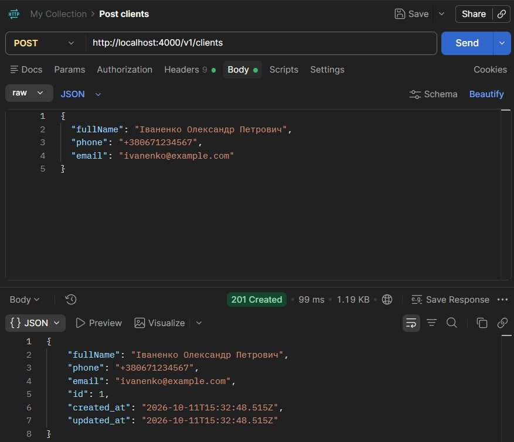
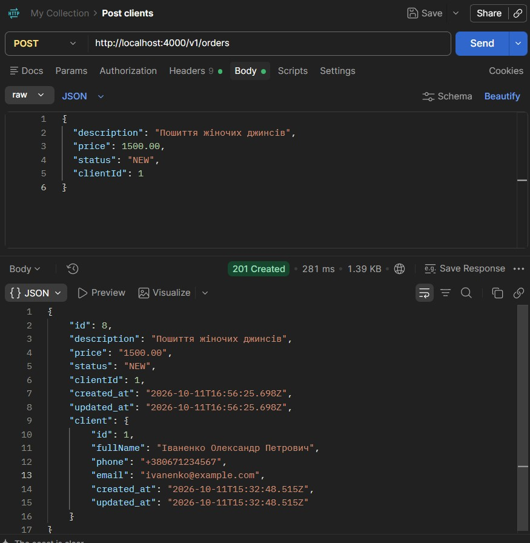
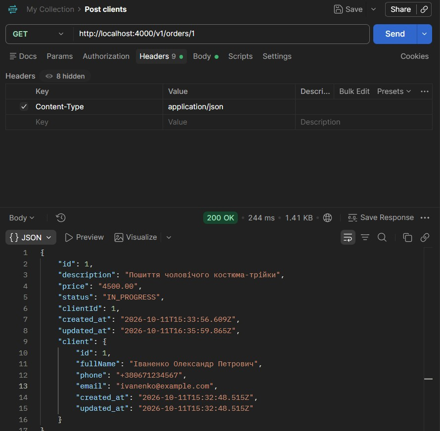
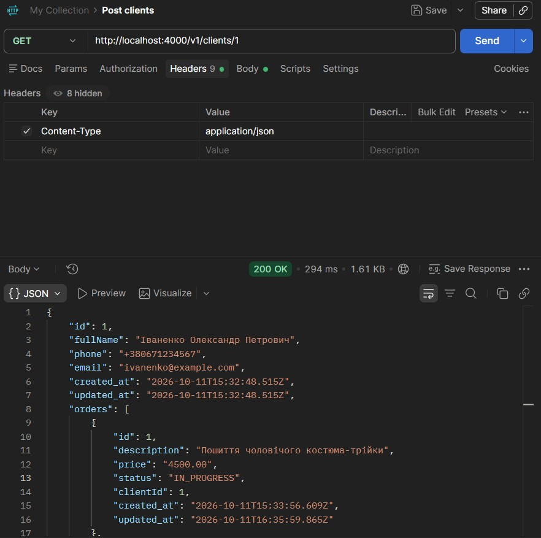

# Лабораторно-практична робота №5: Розширення бекенд-додатку та реалізація REST API

**Предметна область:** Інформаційна система ательє з пошиття одягу

---

## 1. Опис сутностей та зв'язків

У проекті реалізовано дві пов'язані сутності за допомогою TypeORM:

1. **Client (`clients`)** — зберігає інформацію про клієнтів ательє (`id`, `fullName`, `phone`, `email`).
2. **Order (`orders`)** — зберігає інформацію про замовлення на пошиття та ремонт одягу (`id`, `description`, `price`, `status`, `clientId`).

**Тип зв'язку:** `One-To-Many` (Один до Багатьох) між `Client` та `Order` (один клієнт може мати кілька замовлень, але кожне замовлення належить конкретному клієнту).

---

## 2. Перелік API Ендпоінтів

### Клієнти (`/v1/clients`)

- `GET /v1/clients` — отримати список усіх клієнтів
- `GET /v1/clients/:id` — отримати клієнта за ID (включаючи масив його замовлень)
- `POST /v1/clients` — створити нового клієнта
- `PATCH /v1/clients/:id` — оновити дані клієнта
- `DELETE /v1/clients/:id` — видалити клієнта

### Замовлення (`/v1/orders`)

- `GET /v1/orders` — отримати список усіх замовлень (з підтягуванням об'єкта `client` через JOIN)
- `GET /v1/orders/:id` — отримати замовлення за ID (з деталями про клієнта)
- `POST /v1/orders` — створити нове замовлення
- `PATCH /v1/orders/:id` — оновити статус або опис замовлення
- `DELETE /v1/orders/:id` — видалити замовлення

---

## 3. Результати тестування (Postman Screenshots)

### 1. Створення клієнта (`POST /v1/clients`)

### 2. Створення замовлення (`POST /v1/orders`)

### 3. Отримання списку замовлень з автоматичним JOIN (`GET /v1/orders`)

### 4. Отримання клієнта з масивом замовлень (`GET /v1/clients/1`)

